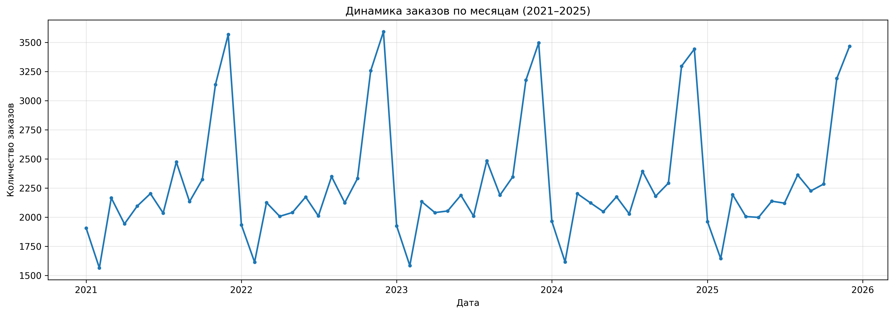
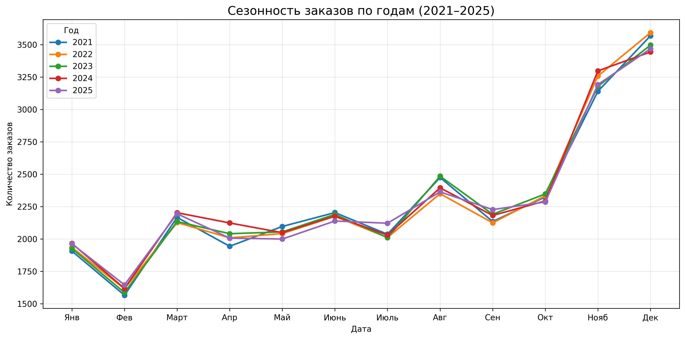
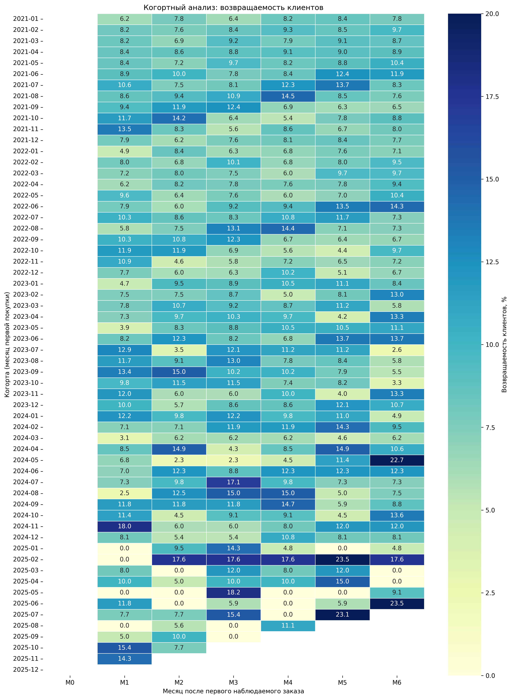
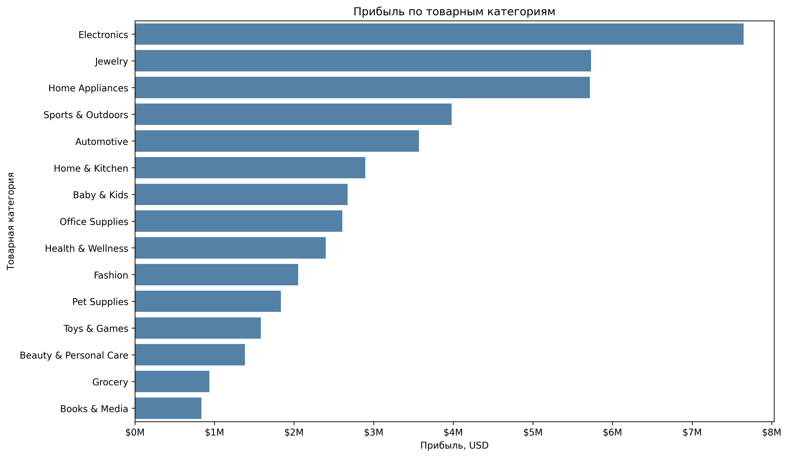
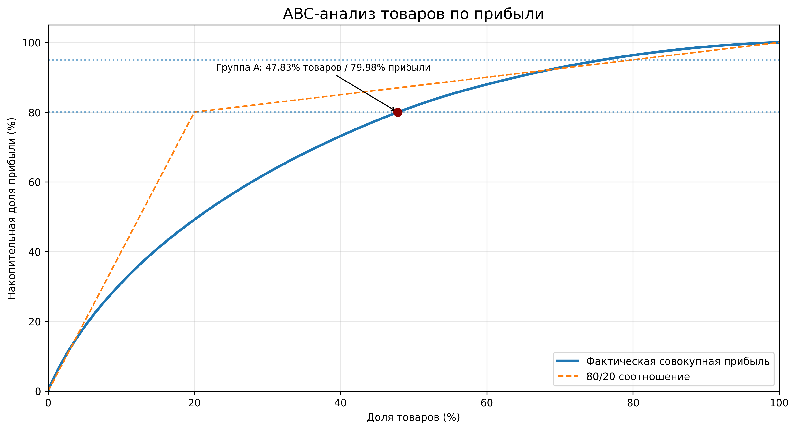

# E-commerce Analytics — SQL & Python

## 1. О проекте

В этом проекте я исследовал данные интернет-магазина за период с 2021 по 2025 год.

Моя цель — понять, как развивается бизнес, какие закономерности наблюдаются в продажах, насколько активно клиенты возвращаются за повторными покупками и какие товары приносят наибольшую прибыль.

Я прошёл весь аналитический процесс: от знакомства с данными и проверки их качества до написания SQL-запросов, визуализации результатов и формирования бизнес-рекомендаций.

## 2. Используемые инструменты

- **PostgreSQL:** хранение данных и выполнение аналитических запросов.
- **SQL:** JOIN, CTE, GROUP BY, оконные функции, когортный и ABC-анализ.
- **Python:** работа с результатами запросов.
- **pandas:** подготовка данных.
- **Matplotlib, Seaborn:** визуализация результатов.
- **Jupyter Notebook:** оформление исследования.

## 3. Исходные данные

Исследование основано на четырёх таблицах:

| Таблица | Описание |
|---|---|
| `raw.orders` | Информация о заказах |
| `raw.order_items` | Товарные позиции заказов |
| `raw.customer_master` | Информация о клиентах |
| `raw.product_catalog` | Каталог товаров |

В таблице заказов содержится 138 116 записей, а в таблице товарных позиций — 397 569 записей.

Период наблюдения: 01.01.2021–31.12.2025.

## 4. Этапы исследования

### Анализ качества данных

Перед расчётом метрик я проверил структуру таблиц, типы данных, диапазон дат и согласованность финансовых показателей.

Обнаружил, что в 11 226 заказах суммы на уровне заказа и товарных позиций расходятся более чем на 0,02.

Поэтому денежные показатели рассматриваются как предварительные. Финансовый анализ ограничен заказами в USD, чтобы не суммировать суммы в разных валютах.

### Динамика и сезонность заказов

**Гипотеза:** количество заказов растёт с каждым годом.

Результат: устойчивого роста не обнаружено. При этом выявлена выраженная сезонность: максимум заказов приходится на ноябрь и декабрь, а минимум — на февраль.

### Анализ клиентов и Retention

**Гипотеза:** клиенты регулярно возвращаются за повторными покупками.

За весь период наблюдения 97,90% клиентов совершили не менее двух заказов. Однако месячный когортный Retention преимущественно находится в диапазоне 5–15%.

Это показывает, что наличие повторных покупок за пять лет не означает высокой частоты покупок каждый месяц.

### Анализ прибыльности товарных категорий

**Гипотеза:** категории с максимальной маржинальностью приносят наибольшую прибыль.

Результат: гипотеза не подтвердилась.

Electronics обеспечивает наибольшую суммарную прибыль — около $7,65 млн, несмотря на маржинальность 32,22%.

Grocery имеет максимальную маржинальность — 53,73%, но её вклад в общую прибыль составляет только 2,04%.

### ABC-анализ ассортимента

**Гипотеза:** 20% товаров формируют 80% прибыли.

Результат: гипотеза не подтвердилась.

- Группа A: 47,83% товаров обеспечивают 79,98% прибыли.
- Группа B: 28,00% товаров обеспечивают 15,01% прибыли.
- Группа C: 24,17% товаров обеспечивают 5,02% прибыли.

Прибыль распределяется по ассортименту более равномерно, чем предполагает классический принцип Парето.

## 5. Бизнес-рекомендации

1. Учитывать сезонность при планировании закупок, складских ресурсов и персонала.
2. Дополнительно исследовать причины низкого месячного Retention.
3. Оценивать товарные категории одновременно по прибыли, выручке и маржинальности.
4. Контролировать доступность наиболее прибыльных товаров группы A.
5. Для товаров группы C дополнительно анализировать оборачиваемость и затраты на хранение, прежде чем принимать решение об изменении ассортимента.

## 6. Ограничения исследования

- Данные охватывают только 2021–2025 годы, поэтому первая наблюдаемая покупка клиента не обязательно является первой покупкой за всю его историю.
- В исходных данных есть расхождения финансовых показателей между заказами и товарными позициями.
- Финансовый анализ проведён по заказам в USD; корректность валюты денежных полей товарных позиций требует подтверждения.
- Анализ не учитывает складские остатки, оборачиваемость и дополнительные затраты на содержание ассортимента.

## 7. Итог

В ходе проекта я применил SQL и Python для исследования продаж, поведения клиентов и эффективности товарного ассортимента.

Главный результат — не только полученные метрики, но и опыт полного аналитического исследования: от постановки вопросов и проверки качества данных до интерпретации результатов и подготовки рекомендаций для бизнеса.